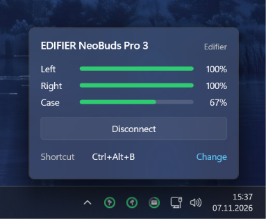

<h1 align="center">Earbuds Tray for Windows</h1>

<p align="center">
  Battery levels of the left bud, the right bud and the case, in the Windows taskbar.
</p>

<p align="center">
  <a href="https://github.com/marcwgls/earbuds-tray-windows/releases/latest"></a>
  
  <a href="LICENSE"></a>
</p>

<p align="center">
  
</p>

Windows shows a single battery value for Bluetooth earbuds, if any, and only in the Settings app. Earbuds Tray reads the individual values directly from the earbuds and keeps them visible in the notification area.

## Features

- One tray icon per bud (and the case, when reported), each with a battery ring
- Popup on left click with battery levels, remaining runtime and a connect / disconnect button
- Remaining runtime estimated from the actual drain of your buds
- Connect or disconnect with a global hotkey (`Ctrl+Alt+B` by default, changeable in the popup)
- Notification when a bud drops below 15 %
- Optional start with Windows
- Native Rust binary, no runtime, no network access, no telemetry

## Supported devices

| Device | Status | Values |
| :--- | :--- | :--- |
| Edifier NeoBuds Pro 3 | Tested | Left, right, case |
| Other Edifier earbuds | Beta | Left, right, case |
| Samsung Galaxy Buds | Beta, read only | Left, right, case (no case on the original Galaxy Buds) |
| Earbuds with Google Fast Pair (Sony, Soundcore, JBL, Nothing, Pixel Buds and others) | Supported | Left, right, case |
| Any other Bluetooth headset | Fallback | One value, as reported by Windows |

Beta devices are marked `(beta)` in the app. They follow the documented protocols but have not been tested on real hardware. If you own one, a short [issue](https://github.com/marcwgls/earbuds-tray-windows/issues) saying whether it works is very welcome.

AirPods are not supported.

## Installation

1. Download `earbuds-tray-setup.exe` from the [latest release](https://github.com/marcwgls/earbuds-tray-windows/releases/latest).
2. Run the installer. It installs for the current user and needs no administrator rights.
3. Pair your earbuds in Windows as usual. The app detects them automatically.

The installer is not code signed, so SmartScreen may show a warning. Choose *More info*, then *Run anyway*.

To uninstall, use *Settings > Apps > Installed apps*.

## How it works

The app picks the best available source for each device:

1. **Vendor channel.** For Edifier and Samsung, the app opens the same Bluetooth channel the vendor's phone app uses. Towards Edifier it sends only the documented battery query. Towards Galaxy Buds it sends nothing and only reads the status the buds publish on their own.
2. **Google Fast Pair.** Many current earbuds publish their battery levels on the Fast Pair message stream. The app listens on that stream and never writes to it.
3. **Windows.** For everything else, the app shows the battery value Windows receives through the hands-free profile.

Some vendor channels accept only one connection at a time. While the phone app is connected, the app falls back to Fast Pair or the Windows value.

The app stores the last used device, the hotkey and a log file in `%LOCALAPPDATA%\earbuds-tray`.

Protocol notes: [Edifier](docs/PROTOCOLS_EDIFIER.md), [device support research](docs/DEVICE_SUPPORT_RESEARCH.md).

## Building from source

Requires [Rust](https://rustup.rs/). The installer additionally needs [Inno Setup 6](https://jrsoftware.org/isdl.php).

```powershell
cargo build --release
cargo test
iscc installer\earbuds-tray.iss   # writes target\installer\earbuds-tray-setup.exe
```

Planned and possible features are listed in the [backlog](docs/BACKLOG.md).

## Acknowledgements

This project builds on protocol research from:

- [mEDIFIER](https://github.com/wh201906/mEDIFIER) and [WearEars](https://github.com/hdzw1155/WearEars) (Edifier)
- [GalaxyBudsClient](https://github.com/timschneeb/GalaxyBudsClient) (Galaxy Buds protocol and test captures)
- [win-bt-stereo-vs-handsfree](https://github.com/Z-M-Huang/win-bt-stereo-vs-handsfree) by Mark.Huang (WinRT Bluetooth transport)
- [BudsLink](https://github.com/maniacx/BudsLink) (earbud and case icons)
- [OpenSCQ30](https://github.com/Oppzippy/OpenSCQ30) (Soundcore research)
- Google's [Fast Pair specification](https://developers.google.com/nearby/fast-pair/specifications/introduction)

See [THIRD_PARTY_NOTICES.md](THIRD_PARTY_NOTICES.md) for licenses.

## License

[GPL-3.0-or-later](LICENSE). Not affiliated with Edifier, Samsung, Google or any other brand mentioned here.
